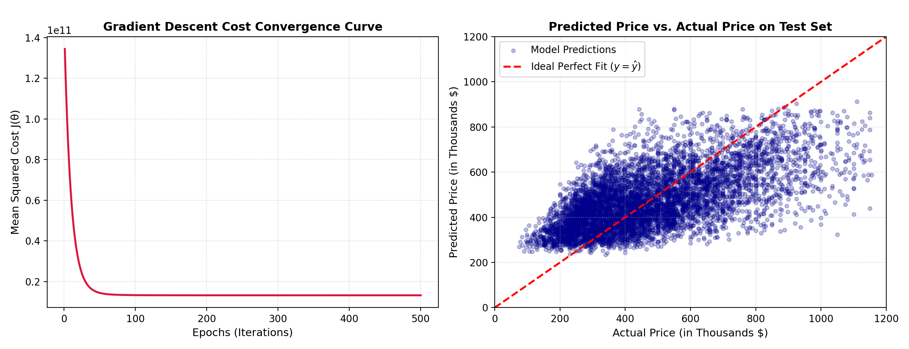
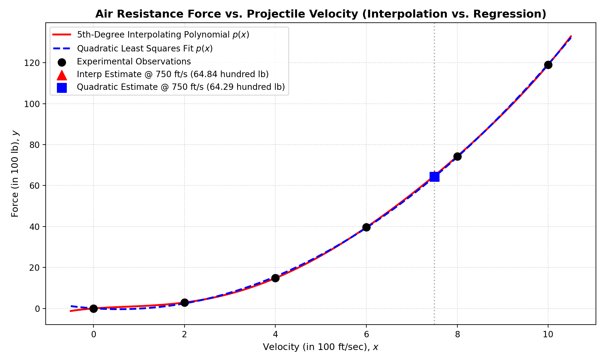
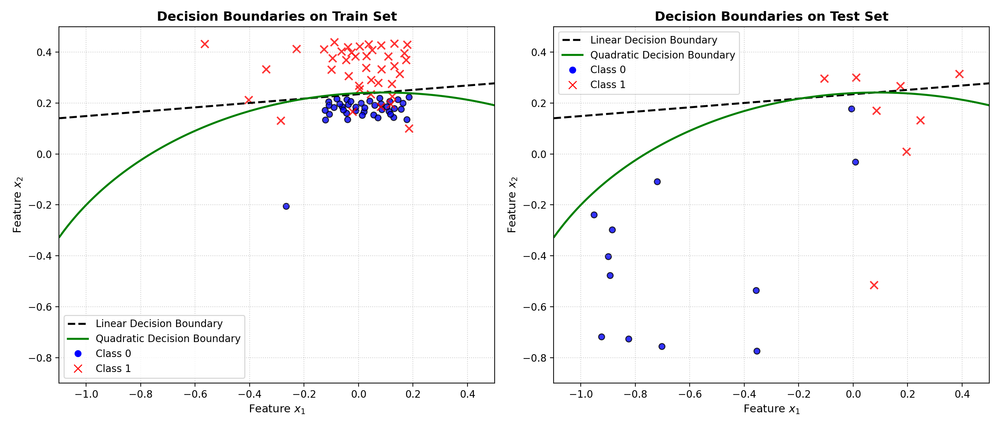
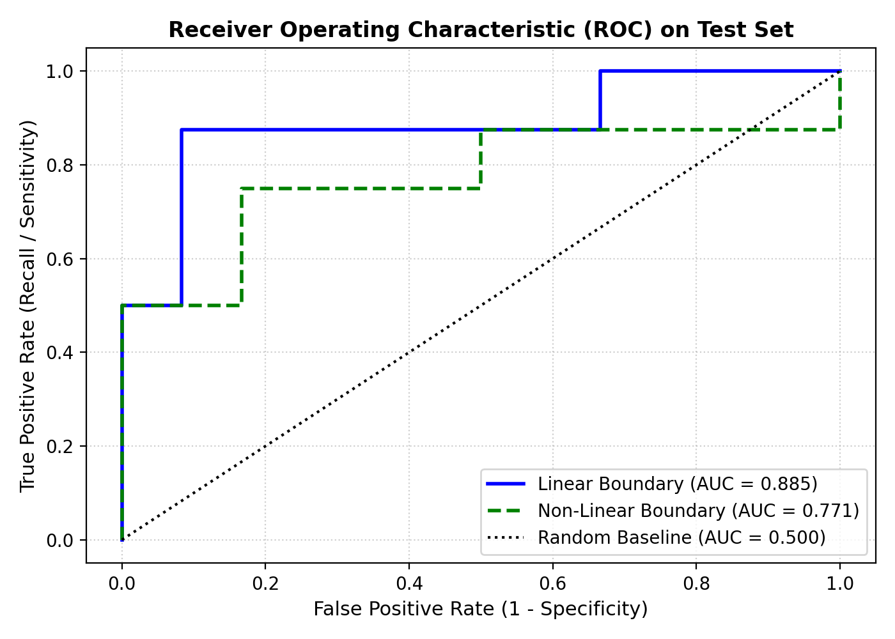

# DS-550 Machine Learning - Assignment 1

**Author:** Muhammad Imran Mian  
**Roll No:** MSDSF25A007  
**Program:** MS Data Science (Batch F26)  
**Institution:** Punjab University College of Information Technology (PUCIT), New Campus Lahore  
**Instructor:** Dr. Syed Muhammad Ali  

---

## 📌 Overview

This repository contains the complete theoretical derivations, numerical implementations, and empirical evaluations for **DS-550: Machine Learning - Assignment 1**. 

The assignment explores foundational machine learning concepts from first principles:
1. **Theoretical Foundations:** Maximum Likelihood Estimation (MLE) connections to Mean Squared Error (MSE) in linear regression and Cross-Entropy loss in logistic regression.
2. **Linear Regression:** Housing price prediction using both analytical closed-form (Normal Equation) and iterative optimization (Batch Gradient Descent with feature scaling).
3. **Polynomial Interpolation vs. Regularized Regression:** Modeling wind tunnel projectile aerodynamic drag force and contrasting Vandermonde interpolation against parsimonious quadratic regression.
4. **Logistic Regression & Decision Boundaries:** Binary classification evaluating linear vs non-linear polynomial decision boundaries and assessing generalization metrics (Accuracy, Precision, Recall, F1, ROC-AUC).

---

## 📂 Repository Structure

```plaintext
Assignment 1/
│
├── Assignment 1.pdf                           # Official assignment problem specification
├── Assignment_1_DS550 - MSDSF25A007.ipynb     # Comprehensive master Jupyter Notebook with derivations & outputs
├── make_notebook.py                           # Python automation script to generate the notebook programmatically
│
├── question2_linear_regression.py             # Python script for Q2 (Housing price prediction)
├── question3_projectile_force.py              # Python script for Q3 (Wind tunnel drag modeling)
├── question4_logistic_regression.py           # Python script for Q4 (Binary classification & decision boundaries)
│
├── q2_linear_regression_results.png           # Q2 visualization: GD convergence & predicted vs actual scatter
├── q3_interpolation_vs_regression.png         # Q3 visualization: 5th-degree interpolation vs quadratic regression
├── q4_decision_boundaries_comparison.png      # Q4 visualization: Linear vs quadratic decision boundary contours
├── q4_roc_curves.png                          # Q4 visualization: ROC curves comparing linear vs polynomial models
│
├── Data/
│   ├── Q2/
│   │   ├── Question 2 Dataset-train.csv       # Training dataset (13,603 house sale records)
│   │   ├── Question 2 Dataset-test.csv        # Test dataset (6,700 house sale records)
│   │   └── Q2.zip                             # Original archive
│   └── Q4/
│       ├── Question 4 Dataset-train.csv       # 2D classification training set (80 samples)
│       ├── Question 4 Dataset-test.csv        # 2D classification test set (20 samples)
│       └── Q4.zip                             # Original archive
│
├── .gitignore                                 # Git ignore file excluding temporary/checkpoint files
├── requirements.txt                           # Project dependencies and environment requirements
└── README.md                                  # Repository documentation (this file)
```

---

## 🔬 Question-by-Question Detailed Solutions

### 📘 Question 1: Theoretical Derivations from Maximum Likelihood Estimation (MLE)

#### Part (i): Linear Regression & Least Squares
* **Probabilistic Setup:** Assumes target $y^{(i)} = \theta^T x^{(i)} + \epsilon^{(i)}$ where noise $\epsilon^{(i)} \stackrel{\text{i.i.d.}}{\sim} \mathcal{N}(0, \sigma^2)$.
* **Likelihood Formulation:**
  $$\mathcal{L}(\theta) = \prod_{i=1}^m \frac{1}{\sqrt{2\pi\sigma^2}} \exp\left(-\frac{(y^{(i)} - \theta^T x^{(i)})^2}{2\sigma^2}\right)$$
* **Log-Likelihood:**
  $$\ell(\theta) = m \ln\left(\frac{1}{\sqrt{2\pi\sigma^2}}\right) - \frac{1}{2\sigma^2} \sum_{i=1}^m (y^{(i)} - \theta^T x^{(i)})^2$$
* **Result:** Maximizing log-likelihood $\ell(\theta)$ is mathematically identical to minimizing the sum of squared errors $J(\theta) = \frac{1}{2m} \sum_{i=1}^m (h_\theta(x^{(i)}) - y^{(i)})^2$.
* **Batch Gradient Descent Update Rule:**
  $$\theta_j := \theta_j - \frac{\alpha}{m} \sum_{i=1}^m (h_\theta(x^{(i)}) - y^{(i)}) x_j^{(i)} \quad \iff \quad \theta := \theta - \frac{\alpha}{m} X^T (X\theta - y)$$

#### Part (ii): Logistic Regression & Cross-Entropy
* **Probabilistic Setup:** For binary labels $y^{(i)} \in \{0, 1\}$, models conditional probability with the sigmoid link:
  $$h_\theta(x) = \sigma(\theta^T x) = \frac{1}{1 + e^{-\theta^T x}}, \quad P(y^{(i)} \mid x^{(i)}; \theta) = (h_\theta(x^{(i)}))^{y^{(i)}} (1 - h_\theta(x^{(i)}))^{1 - y^{(i)}}$$
* **Log-Likelihood:**
  $$\ell(\theta) = \sum_{i=1}^m \left[ y^{(i)} \ln(h_\theta(x^{(i)})) + (1 - y^{(i)}) \ln(1 - h_\theta(x^{(i)})) \right]$$
* **Result:** Minimizing negative log-likelihood (binary cross-entropy loss) yields the gradient:
  $$\frac{\partial J(\theta)}{\partial \theta_j} = \frac{1}{m} \sum_{i=1}^m (h_\theta(x^{(i)}) - y^{(i)}) x_j^{(i)}$$

---

### 🏠 Question 2: Linear Regression for Housing Price Prediction

Predicts house prices based on three continuous features: `bedrooms`, `living_in_m2`, and `real_bathrooms`.

* **Training Set:** 13,603 observations
* **Test Set:** 6,700 observations
* **Methodologies Implemented:**
  1. **Normal Equation (Closed-form Analytical Solution):**
     $$\theta^* = (X^T X)^{-1} X^T y$$
  2. **Batch Gradient Descent (Iterative Optimization):**
     Standardized features using training set z-score statistics ($\mu, \sigma$); trained for 500 epochs with learning rate $\alpha = 0.05$.

#### Learned Model Parameters (Unscaled Features)
* **Intercept ($\theta_0$):** \$168,296.72
* **Bedrooms ($\theta_1$):** -\$35,199.42
* **Living Area in $m^2$ ($\theta_2$):** +\$2,022.37 per $m^2$
* **Real Bathrooms ($\theta_3$):** +\$10,857.64

#### Test Set Performance Comparison

| Optimization Method | RMSE | MAE | $R^2$ Score | Max Prediction Diff |
| :--- | :---: | :---: | :---: | :---: |
| **Normal Equation** | **\$163,372.48** | **\$130,582.33** | **0.3833** | — |
| **Batch Gradient Descent** | **\$163,372.72** | **\$130,583.11** | **0.3833** | $7.77 \times 10^{-1}$ (Equivalence confirmed) |



---

### 🚀 Question 3: Wind Tunnel Projectile Aerodynamic Drag Force

Models projectile air resistance force $y$ (in 100 lb) as a function of velocity $x$ (in 100 ft/sec) using 6 experimental wind tunnel data points.

#### Given Wind Tunnel Data

| Velocity $x$ (100 ft/sec) | 0.0 | 2.0 | 4.0 | 6.0 | 8.0 | 10.0 |
| :--- | :---: | :---: | :---: | :---: | :---: | :---: |
| **Force $y$ (100 lb)** | 0.00 | 2.90 | 14.80 | 39.60 | 74.30 | 119.00 |

#### Fitted Models
1. **5th-Degree Interpolating Polynomial:**
   Solved using Vandermonde matrix linear system $V c = y$:
   $$p_5(x) = 1.7125x - 1.1948x^2 + 0.6615x^3 - 0.0701x^4 + 0.002604x^5$$
2. **Quadratic Least-Squares Regression:**
   Solved via Normal Equation:
   $$p_2(x) = 0.0643 - 1.4875x + 1.3402x^2$$

#### Target Estimation at $v = 750\text{ ft/sec}$ ($x = 7.5$)

| Model | Predicted Force (100 lb) | Predicted Force (lb) | Physical Interpretation |
| :--- | :---: | :---: | :--- |
| **5th-Degree Interpolation** | **64.8384** | **6,483.84 lb** | Passes through every data point, but suffers from mild polynomial oscillations (Runge's phenomenon). |
| **Quadratic Regression** | **64.2931** | **6,429.31 lb** | Aligns directly with aerodynamic physics ($F_{\text{drag}} \propto v^2$), providing a robust generalization. |

* **Absolute Difference:** 54.53 lb (0.84% relative difference).



---

### 🎯 Question 4: Logistic Regression Classifier & Decision Boundaries

Binary classification task over two continuous features $(x_1, x_2)$ across 80 training samples and 20 test samples.

#### Models Evaluated
1. **Linear Decision Boundary Model:** Standard linear combination $z = \theta_0 + \theta_1 x_1 + \theta_2 x_2$.
2. **Quadratic Non-Linear Boundary Model:** 2nd-degree polynomial feature expansion $[1, x_1, x_2, x_1^2, x_1 x_2, x_2^2]$ with $L_2$ regularization.

#### Test Set Performance Metrics

| Metric | Linear Decision Boundary | Quadratic Decision Boundary |
| :--- | :---: | :---: |
| **Accuracy** | **80.00%** | **80.00%** |
| **Precision (Class 1)** | **100.00%** | **100.00%** |
| **Recall (Class 1)** | **50.00%** | **50.00%** |
| **F1-Score** | **0.6667** | **0.6667** |
| **ROC-AUC** | **0.8854** | **0.7708** |
| **Confusion Matrix** | $\begin{bmatrix} \text{TN}=12 & \text{FP}=0 \\ \text{FN}=4 & \text{TP}=4 \end{bmatrix}$ | $\begin{bmatrix} \text{TN}=12 & \text{FP}=0 \\ \text{FN}=4 & \text{TP}=4 \end{bmatrix}$ |

#### Key Insights
* Both models achieve zero false positives ($\text{FP}=0$), leading to 100% precision.
* The linear decision boundary yields a higher ROC-AUC on this test distribution (0.8854 vs 0.7708) due to superior ranking calibration of probabilities near the boundary margin.

| Decision Boundaries | ROC Curves |
| :---: | :---: |
|  |  |

---

## 💻 Installation & Execution

### Prerequisites
* Python 3.9+
* Install all required dependencies using `requirements.txt`:
  ```bash
  pip install -r requirements.txt
  ```

### Running the Python Scripts
```bash
# Question 2: Linear Regression
python question2_linear_regression.py

# Question 3: Projectile Drag Interpolation vs Regression
python question3_projectile_force.py

# Question 4: Logistic Regression & Decision Boundaries
python question4_logistic_regression.py
```

### Generating / Launching the Jupyter Notebook
```bash
# Regenerate the notebook
python make_notebook.py

# Launch JupyterLab / Jupyter Notebook
jupyter notebook "Assignment_1_DS550 - MSDSF25A007.ipynb"
```

---

## 📜 Academic Integrity & License
This project is submitted for academic evaluation in **DS-550: Machine Learning** at **PUCIT New Campus Lahore**. All solutions and code implementations are authored by Muhammad Imran Mian (Roll No: MSDSF25A007).
